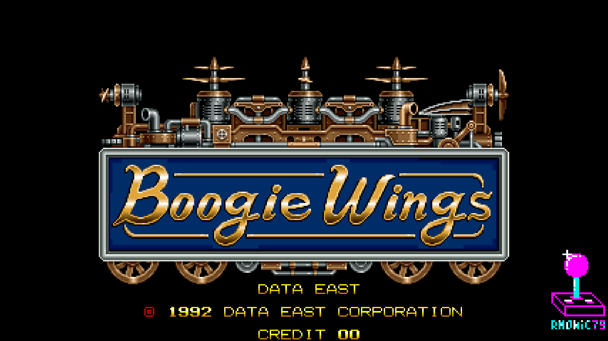
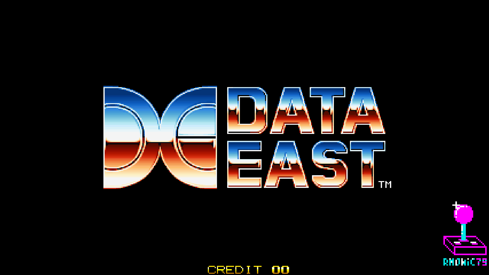
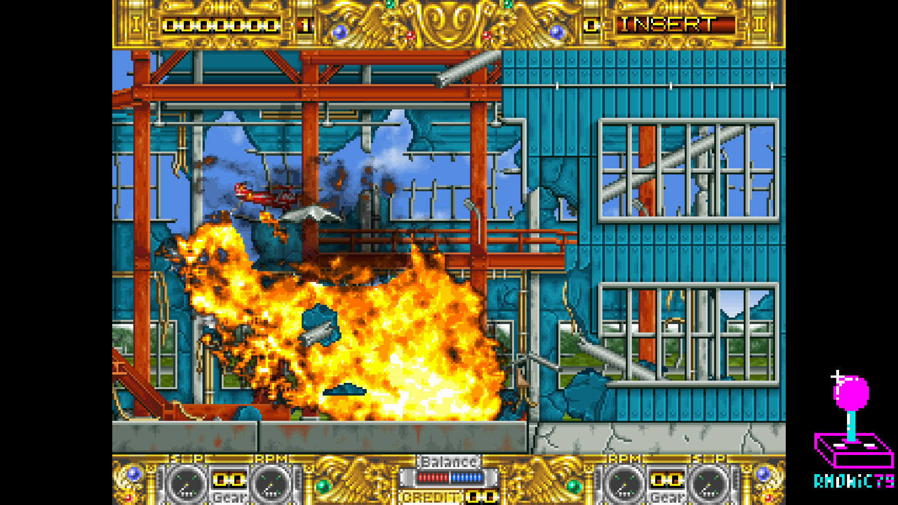
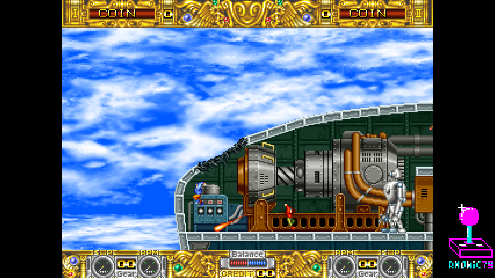
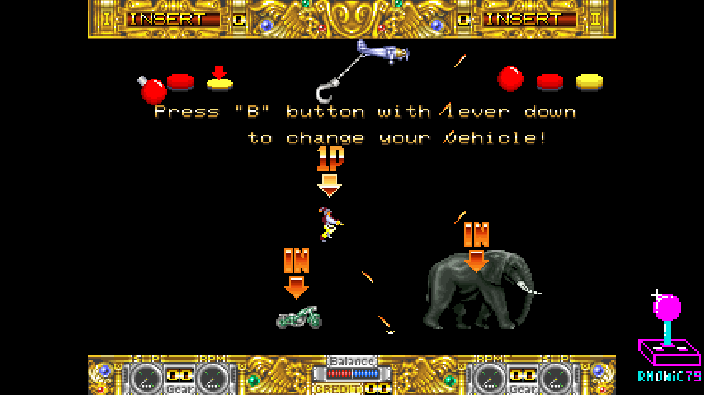
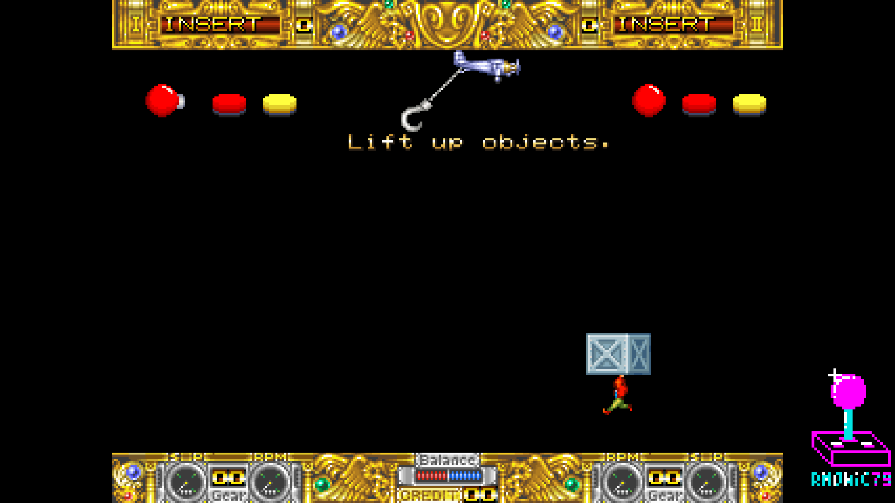
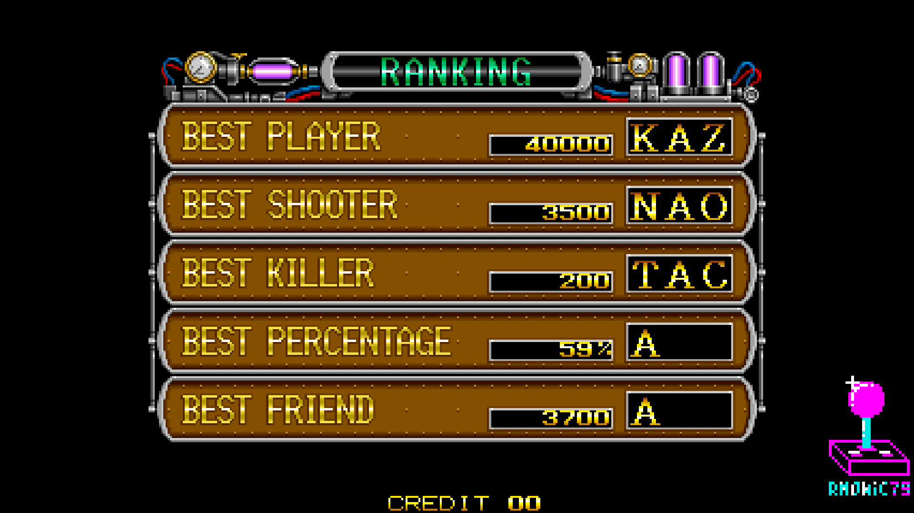

# rm_BoogieWings_Pocket

Analogue Pocket (openFPGA) core for **Boogie Wings** (also known as **The
Great Ragtime Show**, Data East Corporation, 1992).

It is the Pocket port of my MiSTer core
[rm_BoogieWings_MiSTer](https://github.com/rmonic79/rm-BoogieWings_MiSTer):
the same reimplementation of the **Data East DE-0297 board** — 68000 main CPU,
HuC6280 sound CPU, two DECO16IC tilemap chips (four scrolling playfields), a
custom sprite generator, the DECO ACE alpha-blend mixer, DECO104 protection,
and YM2151 + dual OKI M6295 audio — inside a frame made for the Pocket.

The `rm` prefix marks my own cores.

---

## About the game

**Boogie Wings** (*The Great Ragtime Show* in Japan) is a horizontally
scrolling shoot-'em-up with a twist: you pilot a WWI-era biplane, but you
can bail out at any moment and drop down to fight on foot, grabbing a
grappling hook to swing across the stage, hijack enemy vehicles, and hurl
objects at your foes. The mix of aerial and ground combat, the destructible
scenery and the hand-drawn cartoon art make it one of Data East's most
distinctive action games. The DE-0297 board pushes four scrolling
playfields blended through the DECO ACE mixer, giving the game its layered,
colourful look.

## Status

**Current version: 1.8** (November 2026), from the MiSTer core 1.8.

**What the Pocket version has**
- The five ROM sets listed below, with video, audio (YM2151 and two OKI
  M6295) and controls for two players.
- Standard MAME ROMs: all the decryption (DE102 opcodes, DECO56 tiles) is
  done in the FPGA.
- Core settings menu: the DIP switches (Coin A, Coin B, Flip Screen, Continue
  Coin, Lives, Difficulty, Coin Slots, Stage Reset, Demo Sounds) and Reset.
- Memories (savestates) and sleep.
- Autofire: hold **Select** and press **A** or **B** to change the rate of
  that button: off, 10, 15, 30, off again. The rates are counted in game
  frames (3+3, 2+2 and 1+1 frames), so at the game's 57.8 Hz they are about
  9.6, 14.5 and 28.9 shots per second. A small box on the screen shows the
  button and its rate for about two seconds. Select pressed and released
  alone is the Coin button.
- Pause on **L**, with the pause overlay (logo and supporters list).
- Dock support.
- Native 57.8 Hz refresh.

**Not in the Pocket version** (compared to the MiSTer OSD)
- The 60 Hz refresh mode.
- The per-channel audio gains (FM, OKI0, OKI1) and the Presence control.
- CRT Adjust, CRT V-Size, aspect ratio and scale: on the Pocket the scaler
  does that job.
- Clean Pause and the layer on/off switches.
- The 32 savestate slots: the Pocket uses its own Memories.

**ROM sets supported**
- Boogie Wings (`boogwing`, Euro v1.5, 92.12.07) — parent
- Boogie Wings (`boogwinga`, Asia v1.5, 92.12.07)
- Boogie Wings (`boogwingu`, USA v1.7, 92.12.14)
- The Great Ragtime Show (`ragtime`, Japan v1.5, 92.12.07)
- The Great Ragtime Show (`ragtimea`, Japan v1.3, 92.11.26)

## Screenshots

| | |
|---|---|
|  |  |
| Title screen | Data East |
|  |  |
| Gameplay | Gameplay |
|  |  |
| Tutorial | Tutorial |
|  | |
| High scores | |

## Hardware emulated

| Component        | Spec                                                |
|------------------|-----------------------------------------------------|
| Main CPU         | M68000 @ 14 MHz (DE102 encrypted opcodes)           |
| Sound CPU        | HuC6280 @ 8.055 MHz                                  |
| Sound chip 1     | Yamaha YM2151 OPM (jt51)                             |
| Sound chip 2     | OKI M6295 (jt6295) ×2 — 1 MHz and 2 MHz             |
| Tilemaps         | DECO16IC ×2 (four playfields, 16×16 / 8×8)          |
| Sprites          | DECO_SPRITE ×2 (alpha-blend)                         |
| Palette / mixer  | DECO ACE (palette + alpha-blend + fade)             |
| I/O + protection | DECO104                                             |

## Installation

**ROMs are NOT included.** You build them from your own MAME zip files with
the tool in the release package. Use only ROMs you are legally entitled to.

1. Download the release zip from the [Releases](../../releases) page.
2. Put your MAME zip files in `make_roms/roms`. Merged, split and non-merged
   sets all work; with a merged set, `boogwing.zip` alone is enough.
3. Run `make_roms/make_roms.bat` (Windows) or `sh make_roms/make_roms.sh`
   (Linux). On macOS, mra-tools-c has no binary: see
   [mra-tools-c](https://github.com/mist-devel/mra-tools-c) (Docker).
   The `.rom` files are written to `SD/Assets/boogiewings/common`; the
   README in the package lists their expected MD5.
4. Copy the contents of the `SD` folder to the root of your Pocket's SD card.
5. On the Pocket, open openFPGA, start Boogie Wings and pick the version.

## Controls

| Pocket | Game  |
|--------|-------|
| D-pad  | Move  |
| A      | Shot  |
| B      | Bomb  |
| Start  | Start |
| Select | Coin  |
| L      | Pause |

Player 2 uses a second controller in the Dock.

## How the port works

- `Template.sv` and `rtl/` are the MiSTer core: the same game RTL, with a few
  memory and timing changes to fit the Pocket's FPGA, marked `POCKET:` in the
  comments.
- `core/` is the Pocket frame. It plays the part of the MiSTer HPS (ROM
  download, DIP switches, settings and savestate commands go to the core
  through the same `hps_io` interface), maps the MiSTer DDR3 regions to the
  Pocket's PSRAM (sprite ROMs 2 × 4 MB, OKI samples 1 MB, savestate 2 MB),
  and handles video, audio, controls, autofire and its on-screen box.

## Building from source

Requires Quartus Prime Lite 17.0. The FPGA is a Cyclone V 5CEBA4F23C8.

```
quartus_sh --flow compile rmBoogieWingsP
```

or open `rmBoogieWingsP.qpf` in Quartus and run Start Compilation.

The pre-flow script generates `build_id.v` and `apf/build_id.mif` at every
build. The post-flow script writes `output_files/rmBoogieWingsP.rbf_r`, the
bit-reversed bitstream the Pocket loads. On the SD card it goes to
`Cores/rmonic79.BoogieWings/bitstream.rbf_r`.

## Repository layout

```
rm_BoogieWings_Pocket/
├── rtl/                 Game RTL (the MiSTer core)
│   ├── boogwings/       Boogie Wings-specific logic
│   ├── common/          DECO104, DE102/DECO56 decryption, savestate, pause overlay, bridges
│   ├── HUC6280/         HuC6280 sound CPU
│   ├── fx68k/           FX68K M68000 cycle-accurate core
│   ├── jt51/            YM2151 FM synth
│   ├── jt6295/          OKI M6295 ADPCM
│   ├── jtframe/         JTFRAME framework modules
│   ├── sound/           JTFRAME audio
│   ├── jtframe_sdram64* SDRAM controller (JTFRAME SDRAM64)
│   └── pll.v            Core clock PLL
├── core/                Pocket frame: MiSTer HPS emulation, PSRAM, video, audio, autofire
├── apf/                 Analogue Pocket Framework (Analogue)
├── pocket/              Pocket settings (pocket_cfg.vh) and PLL configuration
├── sys/                 hps_io.sv from the MiSTer framework
├── logo/                Pause overlay logo, font and text
├── docs/                Screenshots
├── Template.sv          Core top level (MiSTer emu module)
├── Template.sdc         Timing constraints
├── rmBoogieWingsP.qpf   Quartus project
├── rmBoogieWingsP.qsf   Quartus assignments
├── jt6295_up4.hex       OKI 4x interpolation filter coefficients
├── AUTHORS.md           Credits and licenses of the components
└── LICENSE              GNU GPL v3
```

## Acknowledgements

- **Jose Tejada** ([@jotego](https://github.com/jotego)) for JT51 (YM2151),
  JT6295 (OKI M6295) and the JTFRAME framework (including SDRAM64).
- **Sergey Dvodnenko** ([@srg320](https://github.com/srg320)), with **Sorgelig**
  and **David Shadoff**, for the HuC6280 core (from the MiSTer TurboGrafx-16 /
  PC Engine core); original design by **Gregory Estrade** (FPGAPCE).
- **Jorge Cwik** ([ijor](https://github.com/ijor)) for the **FX68K**
  cycle-accurate M68000 core.
- **Martin Donlon** ([wickerwaka](https://github.com/wickerwaka)) for the
  savestate infrastructure, ported from the Arcade-TaitoF2 core.
- The **MAMEDev team** for the invaluable reference on the DECO16IC tilemaps,
  DECO104 protection, DECO ACE mixer, memory maps and timing.
- **Analogue** for the Analogue Pocket, openFPGA and the Analogue Pocket
  Framework.

## Support this project

If you enjoy this core and want to support its development:

- [Ko-fi](https://ko-fi.com/ibecerivideoludici) — one-time support
- [Patreon](https://www.patreon.com/IBeceriVideoludici) — monthly support
- [PayPal](https://www.paypal.me/IBeceriVideoludici) — one-time donation

## Follow

- [GitHub](https://github.com/rmonic79)
- [Twitch](https://twitch.tv/ibecerivideoludici) — live streams
- [YouTube](https://www.youtube.com/c/IBeceriVideoludici) — playlists and videos
- [X / Twitter](https://x.com/rmonic79)

## License

The RTL source code in this repository is provided as-is for educational
and preservation purposes under **GNU GPL v3 or later**. The Analogue Pocket
Framework files in `apf/` belong to Analogue and are under their license.
Original ROM data is not included; users must provide their own legally
obtained copies.

Original *Boogie Wings* / *The Great Ragtime Show* arcade hardware
© Data East Corporation, 1992.
